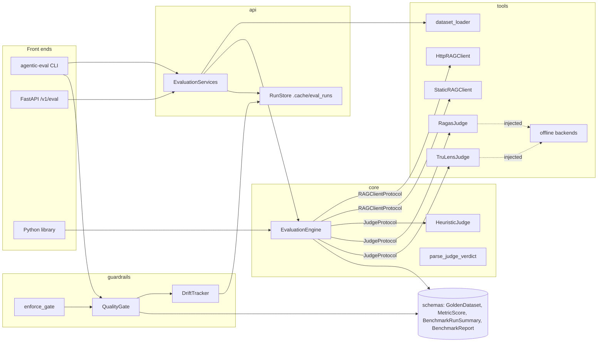
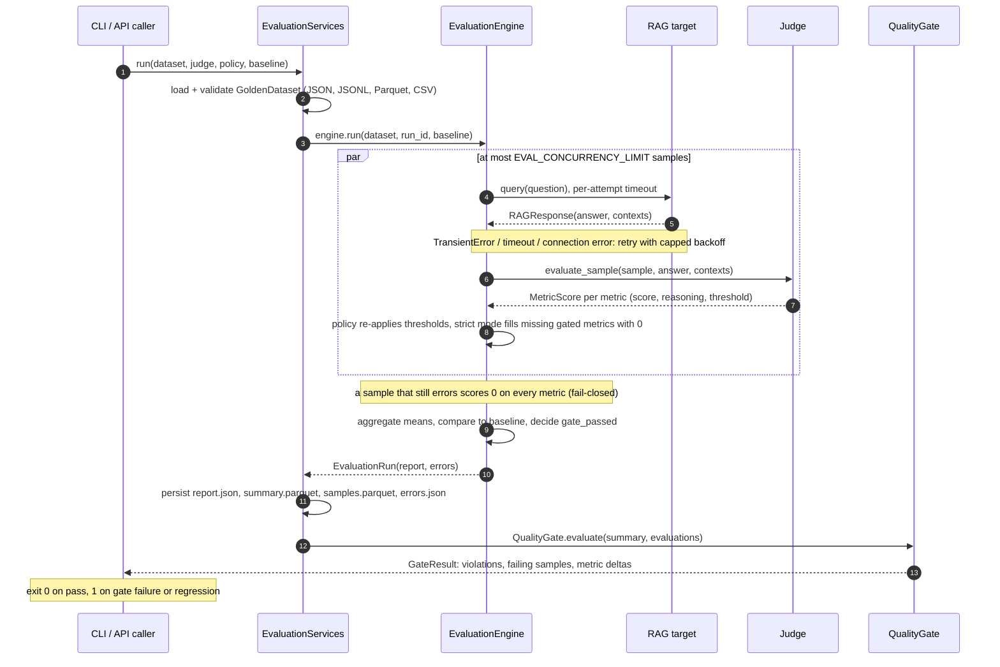
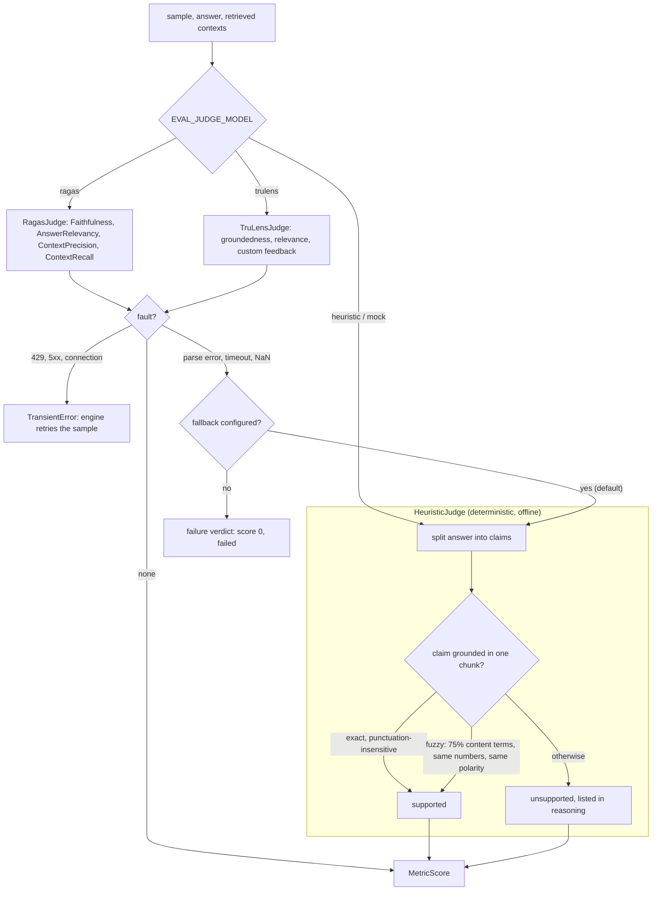
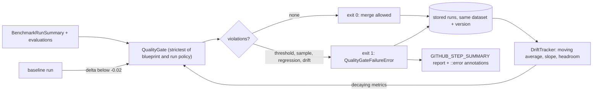

# agentic-eval-benchmark

LLM-as-a-Judge evaluation pipeline for retrieval-augmented generation (RAG) endpoints. It sends
every question of a versioned Golden Dataset to the RAG system under test, scores the answers with
an LLM judge (Ragas, TruLens) or a deterministic offline judge, and gates the run on
**Faithfulness ≥ 0.85** and **Answer Relevancy ≥ 0.85**, on regressions against a baseline run and
on gradual drift across runs. A failed gate exits non-zero, so it blocks CI and pull requests.

- **One pipeline, three front ends**: the `agentic-eval` CLI, a FastAPI service (`/v1/eval`) and
  a Python library share one service layer.
- **Fails closed**: an unreachable endpoint, a judge that cannot be parsed or a missing metric
  scores 0 and fails the sample; it can never pass the gate by omission.
- **Hermetic by default**: the offline heuristic judge and an oracle RAG target run the whole
  pipeline with no network, no model and no credentials; telemetry of every library is disabled.
- **Strict contracts**: frozen, strict Pydantic v2 schemas whose validators make contradictory
  results (a passing gate with a failing mean) unrepresentable.
- **Python 3.13**, `mypy --strict`, 374 hermetic tests at 99.29% branch coverage.

## Contents

- [Architecture](#architecture)
- [Quickstart](#quickstart)
- [CLI](#cli)
- [HTTP API](#http-api)
- [Golden Dataset guide](#golden-dataset-guide)
- [Judges and metrics](#judges-and-metrics)
- [Quality gate, regressions and drift](#quality-gate-regressions-and-drift)
- [CI/CD integration](#cicd-integration)
- [Docker](#docker)
- [Configuration reference](#configuration-reference)
- [Quality and compliance guarantees](#quality-and-compliance-guarantees)
- [Known limitations](#known-limitations)
- [Development](#development)
- [License](#license)

## Architecture

The package is layered: `schemas` (immutable contracts) ← `core` (engine, offline judge, verdict
parser) ← `tools` (Ragas/TruLens adapters, loaders, RAG clients) and `guardrails` (gate, drift,
CI blocker) ← `api` (service layer, FastAPI) and `cli`. The engine depends only on two ports,
`RAGClientProtocol` and `JudgeProtocol`, so targets and judges are swappable.



### Evaluation lifecycle



### Provider judges and the offline judge

Provider judges are isolated behind the same `JudgeProtocol` as the deterministic heuristic
judge. Their faults are classified so that only transport faults are retried, while parse
errors, timeouts and invalid scores degrade to the heuristic judge (or to a failing verdict).



### Quality gate and drift loop



## Quickstart

```bash
uv sync                                            # Python 3.13 + locked dependencies
uv run agentic-eval run --oracle --format markdown # whole pipeline, offline, no credentials
```

`--oracle` answers each question from the dataset itself, so the run checks the pipeline (and
must pass the gate) without a RAG endpoint. On this machine, `direnv allow` first pins every cache,
the virtualenv and run storage under `./.cache/` on the project SSD (see
[CONTRIBUTING.md](CONTRIBUTING.md)).

Against a real RAG endpoint (the defaults match the `rag_documents` service):

```bash
export EVAL_RAG_URL=http://127.0.0.1:8000/rag/answer
uv run agentic-eval verify                       # dataset, storage, judges, endpoint reachability
uv run agentic-eval run --run-id baseline        # heuristic judge, offline scoring
uv run agentic-eval run --baseline baseline      # fails (exit 1) on a regression
```

With an LLM judge through any OpenAI-compatible endpoint:

```bash
export EVAL_JUDGE_MODEL=ragas
export EVAL_PROVIDER_LLM_MODEL=<model-id> EVAL_PROVIDER_EMBEDDING_MODEL=<embedding-model-id>
export EVAL_PROVIDER_API_KEY=...                 # or EVAL_PROVIDER_BASE_URL for a local server
uv run agentic-eval run --format markdown
```

As a library (the HTTP target and judges are swappable behind the same two ports):

```python
import asyncio
from pathlib import Path

from agentic_eval_benchmark.core import (
    BenchmarkSettings,
    EvaluationEngine,
    HeuristicJudge,
    write_run,
)
from agentic_eval_benchmark.guardrails import QualityGateFailureError, enforce_gate
from agentic_eval_benchmark.schemas import MetricType
from agentic_eval_benchmark.tools import StaticRAGClient, load_reference_dataset


async def main() -> None:
    dataset = load_reference_dataset()
    settings = BenchmarkSettings(output_dir=Path(".cache/eval_runs"), concurrency_limit=4)
    engine = EvaluationEngine(
        StaticRAGClient.from_dataset(dataset), HeuristicJudge(), settings=settings
    )
    run = await engine.run(dataset, run_id="library-demo")
    write_run(run, settings.output_dir)
    print(run.summary.gate_passed, run.summary.mean_score(MetricType.FAITHFULNESS))  # True 1.0
    try:
        enforce_gate(run.summary, evaluations=run.report.evaluations)
    except QualityGateFailureError as failure:
        print(failure.markdown)
        raise SystemExit(1) from failure


asyncio.run(main())
```

## CLI

`agentic-eval` (also `python -m agentic_eval_benchmark`). Results go to stdout, so
`--format json | jq` works; progress, warnings and errors go to stderr.

| Exit code | Meaning |
|---:|---|
| `0` | Quality gate passed / command succeeded |
| `1` | Quality gate failed, including a regression against `--baseline` or drift (`gate`) |
| `2` | Invalid input or configuration: bad dataset, option, setting, unknown run or baseline |
| `3` | Unexpected internal error (never reported as a gate failure) |

### `run`: evaluate a dataset

| Option | Default | Description |
|---|---|---|
| `--dataset-path PATH` | built-in reference | `.json`, `.jsonl`/`.ndjson`, `.parquet`/`.pq` or `.csv` |
| `--rag-url URL` | `EVAL_RAG_URL` | RAG endpoint to evaluate |
| `--oracle` | off | answer from the dataset itself (offline smoke test) |
| `--judge-model` | `EVAL_JUDGE_MODEL` | `heuristic`, `mock`, `ragas` or `trulens` |
| `--threshold-faithfulness F` | `0.85` | faithfulness gate; strict mode forbids values below 0.85 |
| `--threshold-relevancy F` | `0.85` | answer relevancy gate; same floor |
| `--non-strict` | off | allow thresholds below 0.85; gate on means only |
| `--regression-tolerance F` | `0.02` | allowed drop of a metric mean against the baseline |
| `--baseline RUN` | none | baseline run ID or report path |
| `--run-id ID` | generated | `run-<UTC timestamp>-<6 hex>`; must be unique |
| `--output-dir PATH` | `EVAL_OUTPUT_DIR` | run storage |
| `--concurrency N` | `EVAL_CONCURRENCY_LIMIT` | samples in flight (1-256) |
| `--format` | `table` | `table`, `json` (summary) or `markdown` |

```console
$ agentic-eval run --oracle --run-id demo-oracle --format json
Evaluating synthetic-rag-reference v1.0.0 (8 samples) with the heuristic judge…
Saved to <project>/.cache/eval_runs/demo-oracle
✔ quality gate passed: demo-oracle
{
  "run_id": "demo-oracle",
  "dataset_name": "synthetic-rag-reference",
  "dataset_version": "1.0.0",
  "total_samples": 8,
  "passed_samples": 8,
  "pass_rate": 1.0,
  "failed_sample_ids": [],
  "metrics": [
    {"metric": "faithfulness", "aspect": null, "count": 8, "mean": 1.0, "minimum": 1.0,
     "maximum": 1.0, "pass_rate": 1.0},
    ...
  ],
  "policy": {"faithfulness_min": 0.85, "relevancy_min": 0.85, "context_precision_min": null,
             "context_recall_min": null, "regression_tolerance": 0.02, "strict_mode": true},
  "gate_passed": true,
  "regression_status": "no_baseline",
  ...
}
```

Against an unreachable endpoint the run fails closed:

```console
$ agentic-eval run --rag-url http://127.0.0.1:9/rag/answer --run-id demo-down
Evaluating synthetic-rag-reference v1.0.0 (8 samples) with the heuristic judge…
8 sample(s) could not be evaluated (see errors.json)
Saved to <project>/.cache/eval_runs/demo-down
          demo-down · gate FAILED · 0/8 samples passed · no baseline
(metric table: every metric 0.000, faithfulness and answer_relevancy marked fail)
✖ quality gate FAILED: demo-down
  • [metric_below_threshold] faithfulness mean 0.000 is below the 0.85 threshold.
  • [metric_below_threshold] answer_relevancy mean 0.000 is below the 0.85 threshold.
  • [sample_failures] 8 of 8 samples failed; strict mode requires every sample to pass.
$ echo $?
1
```

### `report`: inspect a stored run

`agentic-eval report TARGET [--format markdown|table|json] [--export out.json|out.parquet]`.
`TARGET` is a run ID, a run directory or a `report.json`. `json` prints the full report
(summary plus per-sample evaluations); `--export` writes the full report (`.json`) or one row per
sample and metric (`.parquet`).

```markdown
# Benchmark run `demo-oracle`

**Quality gate: ✅ PASSED**

| Metric | Mean | Min | Max | Pass rate | Threshold | Status |
|---|---:|---:|---:|---:|---:|---|
| `faithfulness` | 1.000 | 1.000 | 1.000 | 100.0% | 0.85 | ok |
| `answer_relevancy` | 1.000 | 1.000 | 1.000 | 100.0% | 0.85 | ok |
| `context_precision` | 1.000 | 1.000 | 1.000 | 100.0% | - | info |
| `context_recall` | 1.000 | 1.000 | 1.000 | 100.0% | - | info |
```

Failed runs add a "Failed samples" table with each failing metric's judge reasoning.

### `verify`: check a setup

`agentic-eval verify [--dataset-path PATH] [--rag-url URL] [--judge-model M] [--skip-rag]` checks
that storage is writable, the dataset validates, the offline judge scores, ragas and trulens are
importable, the selected judge is configured and builds, and (unless `--skip-rag`) that the
endpoint answers the first question. Exit `0` when every check passes, `2` otherwise.

### `gate`: the fail-CI hook

`agentic-eval gate TARGET [--baseline RUN] [--tolerance-delta F] [--drift/--no-drift]
[--drift-window 5] [--drift-min-history 3] [--drift-max-decline 0.03] [--step-summary PATH]
[--format ansi|markdown|json]` re-gates a stored run with the stricter of the blueprint policy and
the run's own policy. It appends a Markdown report to `--step-summary` (default
`$GITHUB_STEP_SUMMARY`) and, under GitHub Actions, emits one `::error` annotation per violation.

```console
$ agentic-eval gate demo-down --baseline demo-oracle --no-drift
✖ quality gate FAILED: demo-down
  • [metric_below_threshold] faithfulness mean 0.000 is below the 0.85 threshold.
  • [metric_below_threshold] answer_relevancy mean 0.000 is below the 0.85 threshold.
  • [sample_failures] 8 of 8 samples failed; strict mode requires every sample to pass.
  • [regression] faithfulness dropped 1.000 (1.000 → 0.000) against baseline demo-oracle, beyond the 0.020 tolerance.
  ...
```

`--format json` returns the `GateResult`: `passed`, `violations` (`code`, `metric`, `message`,
`observed`, `expected`), `failing_sample_ids`, `metric_deltas` (`current`, `baseline`, `delta`,
`tolerance`, `regressed`), `baseline_run_id` and `notes`.

### `serve`: the HTTP API

`agentic-eval serve [--host 127.0.0.1] [--port 8080]` runs uvicorn without access logs and
without a `Server` header, with a 10 s graceful shutdown.

## HTTP API

| Method and path | Auth | Purpose |
|---|---|---|
| `POST /v1/eval/run` | API key if set | Run a benchmark synchronously; returns the `BenchmarkRunSummary` |
| `GET /v1/eval/report/{run_id}` | API key if set | Stored `BenchmarkReport` with every per-sample evaluation |
| `GET /v1/eval/report/{run_id}/summary` | API key if set | Stored summary only |
| `GET /v1/eval/health` | open | Status, pinned storage paths, judge availability; 503 when degraded |

When `EVAL_API_API_KEY` is set, send `Authorization: Bearer <key>` or `X-API-Key: <key>`
(compared in constant time). Every response carries `X-Request-ID` (a well-formed client ID is
echoed). Errors are RFC 7807 `application/problem+json` and never echo request content.

### `POST /v1/eval/run`

All body fields are optional; an empty body runs the built-in dataset against `EVAL_RAG_URL`.

| Field | Type | Description |
|---|---|---|
| `dataset` | `GoldenDataset` | inline dataset upload (JSON) |
| `dataset_path` | string | file relative to `EVAL_API_DATASET_DIR`; disabled when unset, cannot escape the root |
| `rag_url` | URL | endpoint override; host must be `EVAL_RAG_URL`'s or in `EVAL_API_ALLOWED_RAG_HOSTS` |
| `oracle` | bool | answer from the dataset (no endpoint call); exclusive with `rag_url` |
| `judge` | string | `heuristic`, `mock`, `ragas` or `trulens` |
| `policy` | `ThresholdPolicy` | thresholds, `strict_mode`, `regression_tolerance` |
| `baseline_run_id` | string | stored run to compare against |
| `run_id` | string | explicit, unique run ID |

```bash
curl -s localhost:8080/v1/eval/run -H "Authorization: Bearer $EVAL_API_API_KEY" \
  -H 'X-Request-ID: req-42' -H 'Content-Type: application/json' \
  -d '{"oracle": true, "run_id": "api-oracle"}'
```

```http
HTTP/1.1 201 Created
Location: /v1/eval/report/api-oracle
X-Eval-Gate: passed
X-Eval-Sample-Errors: 0
X-Request-ID: req-42

{"run_id": "api-oracle", "dataset_name": "synthetic-rag-reference", "dataset_version": "1.0.0",
 "total_samples": 8, "passed_samples": 8, "pass_rate": 1.0, "failed_sample_ids": [],
 "metrics": [{"metric": "faithfulness", "aspect": null, "count": 8, "mean": 1.0, ...}, ...],
 "policy": {"faithfulness_min": 0.85, "relevancy_min": 0.85, "strict_mode": true, ...},
 "gate_passed": true, "regression_status": "no_baseline", ...}
```

A failed gate is still `201`: the run happened and its summary says why; read `X-Eval-Gate` or
`gate_passed`. `GET /v1/eval/report/api-oracle` returns `{"summary": ..., "evaluations": [...]}`,
each evaluation carrying the RAG answer and every metric's score, threshold and reasoning:

```json
{"sample_id": "ref-001-single-hop",
 "answer": "By default, Aurora Cloud Storage replicates every object to three availability zones within the primary region.",
 "metrics": [{"metric": "faithfulness", "aspect": null, "score": 1.0, "threshold": 0.85, "passed": true,
              "reasoning": "1/1 answer claims grounded in the retrieved context (1 exact, 0 fuzzy).",
              "cost_usd": 0.0, "latency_ms": 0.046}, ...],
 "passed": true}
```

### Problem responses

| Status | `type` suffix | Cause |
|---:|---|---|
| 401 | `unauthorized` | missing or wrong API key (`WWW-Authenticate: Bearer`) |
| 403 | `forbidden` | `rag_url` host not allowed; `dataset_path` disabled |
| 404 | `not-found` | unknown run, baseline or dataset file |
| 409 | `conflict` | `run_id` already exists |
| 413 | `payload-too-large` | body over `EVAL_API_MAX_REQUEST_BYTES` (declared or streamed) |
| 415 | `unsupported-media-type` | non-JSON body |
| 422 | `invalid-input` | schema violation, invalid dataset, incomparable baseline |
| 429 | `busy` | all `EVAL_API_MAX_CONCURRENT_RUNS` slots taken (`Retry-After: 30`) |
| 503 | `misconfigured` | provider judge without model, key or optional dependency |
| 500 | `internal-error` / `storage-error` | generic message only |

```json
{"type": "urn:agentic-eval-benchmark:problem:forbidden", "title": "Forbidden", "status": 403,
 "detail": "rag_url host is not in EVAL_API_ALLOWED_RAG_HOSTS", "instance": "urn:request:req-42"}
{"type": "urn:agentic-eval-benchmark:problem:invalid-input", "title": "Unprocessable Content",
 "status": 422, "detail": "Invalid request: policy: Value error, strict_mode forbids faithfulness_min below 0.85",
 "instance": "urn:request:req-42"}
```

Validation details list field locations and pydantic's messages, which never contain the
submitted values: a rejected dataset never appears in the response.

## Golden Dataset guide

### Schema

A `GoldenDataset` is a versioned, non-empty collection of `GoldenSample` with unique IDs. Both
models are frozen and strict: unknown fields, wrong types and implicit coercions are rejected.

| `GoldenDataset` field | Rule |
|---|---|
| `name` | identifier `^[A-Za-z0-9][A-Za-z0-9_.:-]*$`, ≤ 128 chars |
| `dataset_version` | `MAJOR.MINOR.PATCH`; baselines and drift compare like versions |
| `schema_version` | exactly `"1.0.0"`; any other value is rejected, not reinterpreted |
| `description` | optional non-blank text |
| `samples` | at least one `GoldenSample`; `sample_id` values must be unique |

| `GoldenSample` field | Rule |
|---|---|
| `sample_id` | identifier, as above; stable across versions so baselines line up |
| `question` | 3 to 8,192 characters, not blank |
| `contexts` | at least one non-blank reference passage (≤ 32,768 chars each) |
| `ground_truth` | canonical answer, non-blank |
| `metadata` | flat object of strings, numbers, booleans or null; nesting is rejected |

```json
{
  "name": "support-faq",
  "dataset_version": "1.2.0",
  "schema_version": "1.0.0",
  "samples": [
    {
      "sample_id": "faq-001",
      "question": "How long are deleted objects kept?",
      "contexts": ["Deleted objects remain recoverable from the trash for 30 days."],
      "ground_truth": "Deleted objects are kept in the trash for 30 days.",
      "metadata": {"scenario": "numerical_limit", "owner": "storage-team"}
    }
  ]
}
```

### Formats and column aliases

`agentic-eval run --dataset-path` and the API's `dataset_path` load local files only (≤ 64 MiB,
≤ 100,000 samples). The format comes from the suffix:

| Format | Shape |
|---|---|
| `.json` | a full dataset document as above, or a bare list of sample objects |
| `.jsonl` / `.ndjson` | one sample object per line; blank lines skipped |
| `.parquet` / `.pq` | one row per sample; list columns for `contexts`, struct or JSON for `metadata` |
| `.csv` | header row; `contexts` as a JSON array cell (`["a", "b"]`) or a single passage; `metadata` as a JSON object cell |

Columns map onto the schema by name or alias, in priority order:

| Field | Accepted columns |
|---|---|
| `sample_id` | `sample_id`, `id` (missing IDs become `sample-0001`, … in row order) |
| `question` | `question`, `user_input`, `query` |
| `contexts` | `contexts`, `reference_contexts`, `context` |
| `ground_truth` | `ground_truth`, `reference`, `expected_answer` |
| `metadata` | `metadata` |

`answer` and `response` are deliberately not aliases: in most RAG datasets they hold the system's
output, not the reference. Ragas-style exports (`user_input`, `reference_contexts`, `reference`)
load unchanged. Other column names are rejected unless mapped (`field_map={"question": "prompt"}`
in `load_golden_dataset`) or folded into metadata (`extra="metadata"`). Bare rows take the file
stem as `name` and `0.0.0` as `dataset_version`. Errors name the file, row and field, never the
row's content.

### The bundled reference dataset

`synthetic-rag-reference` v1.0.0 (`load_reference_dataset()`, used whenever no dataset is given)
covers eight RAG scenarios over the documentation of a fictional product, Aurora Cloud Storage.
Every fact is invented, so no model can answer from memory.

| Sample | Scenario | Difficulty | Contexts | Question |
|---|---|---|---:|---|
| `ref-001-single-hop` | single_hop_fact | easy | 1 | How many availability zones does Aurora Cloud Storage replicate each object to by default? |
| `ref-002-numerical` | numerical_limit | easy | 1 | What is the maximum size of an object uploaded with a single PUT request? |
| `ref-003-multi-hop` | multi_hop_reasoning | hard | 2 | Which storage class should a team use for compliance archives that are read less than once a year? |
| `ref-004-negation` | negation_exception | medium | 1 | Can deleted objects be recovered after the retention window ends? |
| `ref-005-temporal` | temporal_fact | easy | 1 | When does the legacy v1 API stop accepting requests? |
| `ref-006-enumeration` | enumeration | medium | 1 | Which authentication methods does the Aurora API support? |
| `ref-007-procedural` | procedural_steps | medium | 1 | How do I rotate an API key without downtime? |
| `ref-008-comparison` | comparison | hard | 2 | How does the Standard class differ from the Infrequent-Access class in retrieval cost? |

### Designing a regression-proof dataset

- **Pin identity**: keep `sample_id` stable and bump `dataset_version` whenever samples change.
  Baselines and drift only compare runs of the same dataset name (and, for drift, version).
- **Ground every answer**: each `ground_truth` sentence should be supported by one passage in
  `contexts`; context recall and the heuristic judge check claims chunk by chunk.
- **Cover failure modes, not just facts**: include numbers (hallucinated figures), negations
  (polarity flips), multi-hop questions (two passages), enumerations and procedures, as the
  reference set does. Tag each sample's `metadata.scenario` to slice results.
- **Use invented or private facts** so the judge measures retrieval and grounding rather than the
  model's training data.
- **Make it pass the oracle**: `agentic-eval run --oracle --dataset-path my.json` must clear the
  gate. If the oracle fails, the dataset (not the RAG system) is inconsistent.

## Judges and metrics

| Metric | Heuristic judge (offline) | Ragas judge | TruLens judge |
|---|---|---|---|
| `faithfulness` | share of answer claims grounded in the retrieved context | `Faithfulness` | `groundedness_measure_with_cot_reasons` |
| `answer_relevancy` | `0.7 × max(requested info supplied, question terms addressed) + 0.3 × on-topic share`; evasive answers score 0 | `AnswerRelevancy` (embeddings) | `relevance_with_cot_reasons` |
| `context_precision` | rank-weighted average precision of retrieved chunks | `ContextPrecision` (with reference) | - |
| `context_recall` | share of ground-truth claims grounded in the retrieved context | `ContextRecall` | - |
| `aspect_critique:<name>` | - | - | each `CustomFeedback` / `criteria_feedback` |

- **Heuristic judge**: a claim is *grounded* when it occurs verbatim in one chunk (ignoring case
  and punctuation), or when at least 75% of its stemmed content terms occur in one chunk, it adds
  no number the chunk lacks, and its polarity (negated or not) matches the best-matching
  sentence. Scores are reproducible across runs and platforms; it is a lexical baseline and
  cannot recognise a correct paraphrase with different words.
- **Provider judges** take injected clients: `ragas_llm(client, model, provider="openai" |
  "anthropic")` and `ragas_embeddings(client, model)`; the service builds them from
  `EVAL_PROVIDER_*` with explicit keys only. Rate limits, 5xx and dropped connections raise
  `TransientError` for the engine to retry; parse errors, timeouts and invalid scores are rescored
  by the heuristic judge (`EVAL_PROVIDER_FALLBACK_TO_HEURISTIC`, default on) or become a failing
  verdict whose reasoning names the fault.
- **Structured LLM verdicts**: `parse_judge_verdict` accepts exactly one JSON object with one
  verdict per expected metric and rejects duplicates, extras, out-of-range scores and evidence
  quotes that do not occur in the sources, so a judge cannot justify a score with invented text.
- **Policy owns the thresholds**: the engine re-applies `ThresholdPolicy` to every gated metric
  whatever threshold a judge reports; in strict mode a gated metric the judge omitted scores 0.
- **Offline backends** (`ScriptedRagasLLM`, `HashingEmbeddings`, `ScriptedTruLensProvider`) run
  both provider judges with zero network for tests and air-gapped CI.

## Quality gate, regressions and drift

| Rule | Default | Violation |
|---|---|---|
| Faithfulness mean ≥ threshold | `0.85` | `metric_below_threshold` |
| Answer relevancy mean ≥ threshold | `0.85` | `metric_below_threshold` |
| Gated metric evaluated (strict mode) | on | `metric_missing` |
| Every sample passes (strict mode) | on | `sample_failures` |
| Mean drop vs baseline ≤ tolerance | `0.02` | `regression` |
| No decaying metric across stored runs | on (`gate`) | `metric_drift` |

- **Strict mode** (default) pins the blueprint floor: thresholds can be raised above 0.85 but never
  lowered, and every sample must pass. `--non-strict` allows lower thresholds and gates on means.
- **Regression**: `current − baseline < −tolerance` for any metric present in both runs. Baselines
  must evaluate the same dataset name; a different version is allowed and noted.
- **Drift** (`DriftTracker`) reads earlier stored runs of the same dataset and version and flags a
  metric that (1) is more than `0.03` below its moving average over the last 5 runs, (2) fell in
  every run across at least 4 runs and lost more than `0.03` in total, or (3) clears its gate by
  less than `0.02` while its least-squares slope is negative. Fewer than 3 earlier runs give no
  verdict.
- **CI is never laxer than the run**: `gate` and `enforce_gate` use `strictest_policy()`, the
  highest threshold per metric, the smallest tolerance and strict mode, so a run produced with
  `--non-strict --threshold-faithfulness 0.5` still fails CI. Re-gating re-judges every sample
  under the stricter thresholds.

## CI/CD integration

`.github/workflows/ci.yml` runs on pushes and pull requests to `main`; every action is pinned to a
full commit SHA and the workflow has `contents: read` only.

| Job | Checks |
|---|---|
| `attribution-audit` | sole-contributor identity, full history of the PR head |
| `lint-and-typecheck` | ruff (GitHub annotations), ruff format, `mypy --strict src tests` |
| `security-audit` | Trivy filesystem scan (CRITICAL/HIGH, fixed only), bandit |
| `test-hermetic` | pytest with sockets disabled, branch coverage ≥ 90%, coverage XML artifact |
| `eval-benchmark-gate` | oracle run over the reference dataset, then the blocking `agentic-eval gate` |
| `docker-build` | Buildx build, uid 10001, no installers, healthy with `--network none` and a read-only root |

To block merges when Faithfulness or Answer Relevancy drops below 0.85, make `eval-benchmark-gate`
a required status check in the branch protection rules for `main`. The gate step is plain shell,
so the same two steps gate any pipeline that can reach the RAG system under test:

```yaml
- name: Benchmark the RAG endpoint
  run: uv run agentic-eval run --rag-url "$RAG_URL" --run-id "ci-$GITHUB_RUN_ID" --format markdown
- name: Enforce the quality gate
  run: uv run agentic-eval gate "ci-$GITHUB_RUN_ID" --step-summary "$GITHUB_STEP_SUMMARY"
```

On failure the job summary shows the verdict, each violation with a fix hint, the metric table
(threshold, baseline, delta, trend) and the failing samples with the judge's reasoning, and each
violation appears as an `::error` annotation on the run. To compare against a baseline, restore a
previous run directory into `EVAL_OUTPUT_DIR` (for example from an artifact) and pass
`--baseline`.

## Docker

```bash
docker compose up --build                                   # API on 127.0.0.1:8080
docker compose run --rm eval run --oracle --format json     # one-off CLI run, same hardening
```

The image is a multi-stage build on `python:3.13-slim`: `uv` installs the frozen lockfile (no dev
dependencies, the project as a wheel) and the runtime stage carries only the virtualenv, with no
pip, ensurepip, uv, apt, dpkg binaries, compilers, curl or wget (the dpkg status database stays for
image scanners). It runs as `appuser` (UID/GID 10001, no login shell), keeps all state under
`/app/.cache` and `/tmp`, and its `HEALTHCHECK` probes `/v1/eval/health` with the Python
standard library. The entrypoint is the CLI: the default command is `serve --host 0.0.0.0 --port
8080`, and any other subcommand runs instead.

`docker-compose.yml` adds a read-only root filesystem, `noexec` tmpfs mounts for `/tmp`,
`/app/.cache`, `/app/.cache/eval_runs` and `/app/.cache/trulens`, `user: "10001:10001"`,
`cap_drop: ALL`, `no-new-privileges`, a loopback port binding (`EVAL_BIND`) and CPU, memory and
PID limits. Run reports live on tmpfs and disappear with the container; mount the commented
`eval-runs` volume to keep history for baselines and drift. Copy `.env.example` to `.env` for
secrets.

On macOS, run Docker through `scripts/colima.sh start`: it keeps the Colima VM disk, images and
layers under `./.cache/` on the project SSD and never touches Docker Desktop's socket (see
[CONTRIBUTING.md](CONTRIBUTING.md#containers-docker-via-colima)).

## Configuration reference

Four disjoint environment families; each class reads only its own prefix, values are validated at
startup and unknown keyword arguments are rejected. Collections are JSON
(`EVAL_API_ALLOWED_RAG_HOSTS='["rag.internal"]'`).

### Benchmark (`EVAL_*`)

| Variable | Type | Default | Description |
|---|---|---|---|
| `EVAL_JUDGE_MODEL` | `heuristic` \| `mock` \| `ragas` \| `trulens` | `heuristic` | judge backend; the first two are offline and deterministic |
| `EVAL_CONCURRENCY_LIMIT` | int, 1-256 | `5` | samples evaluated at the same time |
| `EVAL_TIMEOUT_SECONDS` | float, (0, 600] | `30` | per-attempt deadline of one RAG query or judge call |
| `EVAL_RETRY_ATTEMPTS` | int, 0-10 | `3` | retries after the first attempt on transient faults (3 = 4 tries) |
| `EVAL_RETRY_BACKOFF_SECONDS` | float, 0-60 | `0.5` | delay before the first retry; doubles each retry |
| `EVAL_RETRY_BACKOFF_MAX_SECONDS` | float, 0-300 | `8` | cap on one backoff delay; must be ≥ the base |
| `EVAL_OUTPUT_DIR` | path | `.cache/eval_runs` | run storage, also the drift history |

### HTTP service (`EVAL_API_*`)

| Variable | Type | Default | Description |
|---|---|---|---|
| `EVAL_API_API_KEY` | secret, ≥ 32 chars | unset | required by `/run` and `/report` when set; health stays open |
| `EVAL_API_MAX_REQUEST_BYTES` | int, 1 KiB-256 MiB | `16777216` | body limit, enforced on `Content-Length` and on streamed bytes |
| `EVAL_API_MAX_CONCURRENT_RUNS` | int, 1-16 | `1` | runs at once; further triggers get 429 instead of queueing |
| `EVAL_API_DATASET_DIR` | path | unset | root for `dataset_path`; unset disables path references |
| `EVAL_API_ALLOWED_RAG_HOSTS` | JSON list of hosts | `[]` | hosts `rag_url` may target besides `EVAL_RAG_URL`'s; empty keeps the service from becoming an open proxy |

### Judge provider (`EVAL_PROVIDER_*`)

| Variable | Type | Default | Description |
|---|---|---|---|
| `EVAL_PROVIDER_PROVIDER` | `openai` \| `anthropic` | `openai` | `openai` covers any OpenAI-compatible endpoint; `anthropic` needs the `anthropic` extra |
| `EVAL_PROVIDER_LLM_MODEL` | model ID | unset | judge model; required for `ragas` and `trulens` (no stale default) |
| `EVAL_PROVIDER_EMBEDDING_MODEL` | model ID | unset | embedding model for Ragas answer relevancy |
| `EVAL_PROVIDER_EMBEDDINGS` | `provider` \| `hashing` | `provider` | `hashing` uses the offline embeddings; required with `anthropic` |
| `EVAL_PROVIDER_BASE_URL` | URL | unset | OpenAI-compatible base URL; without a key it targets a local server |
| `EVAL_PROVIDER_API_KEY` | secret | unset | the only credential source: the key is always passed explicitly, so `OPENAI_API_KEY` and similar are ignored |
| `EVAL_PROVIDER_REQUEST_TIMEOUT_SECONDS` | float, (0, 600] | `60` | provider client and per-metric timeout |
| `EVAL_PROVIDER_FALLBACK_TO_HEURISTIC` | bool | `true` | rescore metrics the provider judge fails on with the heuristic judge |

`trulens` supports OpenAI-compatible providers only.

### RAG target (`EVAL_RAG_*`)

| Variable | Type | Default | Description |
|---|---|---|---|
| `EVAL_RAG_URL` | URL | `http://127.0.0.1:8000/rag/answer` | endpoint under test |
| `EVAL_RAG_METHOD` | `POST` \| `GET` | `POST` | JSON body for POST, query string for GET |
| `EVAL_RAG_QUERY_FIELD` | string | `query` | request key carrying the question |
| `EVAL_RAG_EXTRA_PAYLOAD` | JSON object | `{}` | constant request fields, e.g. `{"k": 5}` |
| `EVAL_RAG_ANSWER_PATH` | dotted path | `answer` | answer location; integer segments index lists (`choices.0.text`) |
| `EVAL_RAG_CONTEXTS_PATH` | dotted path \| null | `sources` | list of retrieved contexts; null when the endpoint returns none |
| `EVAL_RAG_CONTEXT_TEXT_FIELD` | dotted path \| null | `preview` | text inside each context object; plain strings are used as-is |
| `EVAL_RAG_API_KEY` | secret | unset | sent as `<header>: <scheme> <key>` |
| `EVAL_RAG_API_KEY_HEADER` | header name | `Authorization` | header carrying the key |
| `EVAL_RAG_API_KEY_SCHEME` | string \| null | `Bearer` | prefix; null sends the raw key |
| `EVAL_RAG_HEADERS` | JSON object | `{}` | extra request headers |
| `EVAL_RAG_TIMEOUT_SECONDS` | float, (0, 600] | `30` | HTTP timeout |
| `EVAL_RAG_MAX_RESPONSE_BYTES` | int, 1 KiB-64 MiB | `4194304` | response limit, enforced while streaming |
| `EVAL_RAG_VERIFY_TLS` | bool | `true` | TLS certificate verification |

The client does not follow redirects. HTTP 408, 429, 500, 502, 503, 504 and 529 and transport errors
are retried; other errors and responses that do not fit the mapping fail the sample without a retry.

## Quality and compliance guarantees

**Hermetic runtime.** The heuristic judge and the oracle target need no network, model or
credentials. The test suite runs under pytest-socket (`--disable-socket`) and asserts that sockets
fail; HTTP is exercised through `httpx.MockTransport`. CI starts the container with
`--network none` and requires it to turn healthy and complete an oracle run.

**No telemetry, no stray state.** Ragas usage tracking is forced off, and its user-ID file, which
Ragas writes before honoring the opt-out, is redirected under `XDG_DATA_HOME`. TruLens
OpenTelemetry export is off and its SQLite state is confined to `TRULENS_HOME`; groundedness never
takes the NLTK path that downloads tokenizers at runtime. FastAPI's own OpenTelemetry layer is
disabled in `create_app()`, and Hugging Face telemetry is off in the image and in CI.

**Strict domain schemas.** Every contract is a Pydantic v2 model with
`ConfigDict(frozen=True, extra="forbid", strict=True)`. Validators make contradictory states
unrepresentable: a verdict that disagrees with its threshold, a sample verdict that disagrees with
its metrics, a pass rate that disagrees with its counts, or a passing gate with a failing mean, a
regression or (in strict mode) a failed sample. Reports are re-validated on load. Error details
everywhere list field locations and messages only (`include_input=False`); datasets, answers,
URLs and credentials never reach a response or an exception message.

**Verification.** 374 hermetic tests at 99.29% branch coverage (gate: 90%), `mypy --strict` over
`src` and `tests`, ruff, bandit and a Trivy filesystem scan in CI. Reproduce with:

```bash
uv run pytest tests/ --cov=src/agentic_eval_benchmark --cov-branch --cov-fail-under=90
```

**Contribution policy.** Every commit must be authored and committed by the sole maintainer
identity; AI assistance is disclosed, not hidden. Versioned git hooks enforce it locally,
`scripts/audit-attribution.sh` audits history and CI repeats the audit on the full branch. See
[CONTRIBUTING.md](CONTRIBUTING.md).

## Known limitations

- **Lexical heuristic judge.** It cannot credit a correct paraphrase that shares few words with
  the context, and it rates a wrong but on-topic answer as relevant (faithfulness catches it). Use
  a provider judge for semantic scoring.
- **Truncated contexts.** The `rag_documents` defaults read `sources[].preview`, which that
  service caps at 280 characters; context metrics only see those previews.
- **TruLens provider faults are not retried by the engine.** The TruLens endpoint retries
  internally and re-raises a plain error, which becomes a fallback score or failing verdict.
- **Synchronous API runs.** `POST /v1/eval/run` holds the request until the run finishes; long
  datasets need generous client and proxy timeouts.
- **Drift needs history.** A fresh CI runner has no earlier runs, so drift gives no verdict there
  unless run directories are restored into `EVAL_OUTPUT_DIR`.
- **macOS container tooling.** Lima's DNS forwarder hard-codes `/tmp` for an empty socket
  directory per VM start, and bandit's plugin loader caches under `~/Library/Caches`; neither
  writes project data.

## Development

Work with direnv loaded (`direnv allow`): caches, the virtualenv, run storage and container state
live under `./.cache/` on the project SSD.

```bash
uv sync
uv run ruff check . && uv run ruff format --check .
uv run mypy --strict src tests
uv run bandit -c pyproject.toml -r src
uv run pytest tests/ --cov=src/agentic_eval_benchmark --cov-branch --cov-fail-under=90
scripts/audit-attribution.sh
```

```text
src/agentic_eval_benchmark/
  schemas/      frozen, strict Pydantic contracts: dataset, metrics, benchmark summary and report
  core/         settings, EvaluationEngine, HeuristicJudge, verdict parser, aggregation, persistence
  tools/        Ragas and TruLens judges, dataset loaders, HTTP and static RAG clients, offline backends
  guardrails/   QualityGate, DriftTracker, enforce_gate and CI renderings
  api/          EvaluationServices, settings, routes, problem details, middleware, create_app()
  cli.py        agentic-eval: run, report, verify, gate, serve
  reporting.py  Markdown and terminal renderings
tests/          hermetic pytest suite (pytest-socket, branch coverage >= 90%)
```

## License

[MIT](LICENSE)
